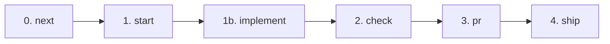

# GitHub Flow

Automate the GitHub issue-to-merge lifecycle through a unified CLI script (`scripts/flow.sh`) and standardized GitHub CLI/GraphQL patterns.

Scope: **Repository Git, Issues & PRs** (`git` + `gh issue` / `gh pr`). Project board sync is out of scope — use `github-projects`.

---

## Workflow Lifecycle



| Step              | Command / action                                   | What It Does                                                                                                                                                                                                                                                                                                                                             |
| ----------------- | -------------------------------------------------- | -------------------------------------------------------------------------------------------------------------------------------------------------------------------------------------------------------------------------------------------------------------------------------------------------------------------------------------------------------- |
| **Init**          | `./scripts/flow.sh init`                           | One-time repo setup: adds `scripts.flow` to `package.json` and creates `.flowrc` from the example (skips either if already present).                                                                                                                                                                                                                     |
| **0. Next**       | `./scripts/flow.sh next [--start]`                 | Lists open backlog issues ordered sequentially after the last closed issue, displays next candidate in queue, and optionally starts work. If backlog is empty and work needs an issue, create one with `gh issue create` (with 1 or more required labels, e.g. `--label "enhancement,area:web"`; see `github-cli`; never MCP write forms), then `start`. |
| **1. Start**      | `./scripts/flow.sh start <issue_no> [slug]`        | Syncs default branch and creates `feature/<slug>` branch.                                                                                                                                                                                                                                                                                                |
| **1b. Implement** | _(no `flow` command — agent/human edits the code)_ | **Required gap between `start` and `check`.** Implement the issue on the feature branch (code, tests, docs). `flow` does not automate this; jumping straight to `check` after `start` is wrong.                                                                                                                                                          |
| **2. Check**      | `./scripts/flow.sh check`                          | Runs verification gates (typecheck, tests, build) and shows git status. Only after implementation is done.                                                                                                                                                                                                                                               |
| **3. PR**         | `./scripts/flow.sh pr <issue_no> [title] [body]`   | Commits changes, pushes branch, opens PR, and links PR to issue via GraphQL.                                                                                                                                                                                                                                                                             |
| **Link**          | `./scripts/flow.sh link <issue_no> <pr_no>`        | Standalone command to link any PR to an issue via GraphQL.                                                                                                                                                                                                                                                                                               |
| **4. Ship**       | `./scripts/flow.sh ship [pr_no]`                   | Squash-merges PR, deletes remote branch, syncs local default branch, closes linked issues, and runs `cleanup` to sweep every merged branch.                                                                                                                                                                                                              |
| **Cleanup**       | `./scripts/flow.sh cleanup [--dry-run]`            | Deletes every deletable branch — locally and on `origin`. Deletable = merged PR exists **or** merging it into the default branch is a no-op. Keeps only default branch and currently checked-out branch.                                                                                                                                                 |
| **Status**        | `./scripts/flow.sh status`                         | Displays active branch and associated PR.                                                                                                                                                                                                                                                                                                                |

### Why there is no `flow implement`

Implementation is the product work itself (edit files, run the app, write tests). A CLI wrapper cannot usefully “do” that. The lifecycle still treats it as an explicit step so agents never treat `start → check` as adjacent commands.

### Commit & PR Titles

`flow.sh pr` derives the commit subject and the PR title from the **issue title** (`custom_title` still overrides both):

| Issue title                                 | Derived title                                      |
| ------------------------------------------- | -------------------------------------------------- |
| `fix(contracts): notes max-length …`        | `fix(contracts): notes max-length … (#276)`        |
| `refactor(core): drop the duplicated shape` | `refactor(core): drop the duplicated shape (#281)` |
| `Add widget` (no conventional type)         | `feat: add widget (#300)`                          |

Rules:

- A title that already starts with a conventional type — `feat` `fix` `refactor` `chore` `docs` `test` `perf` `build` `ci` `revert`, optionally scoped as `fix(contracts):` — keeps that prefix **verbatim**. The subject is not lowercased, because scoped subjects name identifiers (`promptId`, `Playwright`).
- Anything else falls back to `feat: <lowercased cleaned subject>`. Cleaning strips tracker ids (`[Bug]`, `PROJ-123:`), plain or scoped conventional prefixes, and surrounding punctuation.

### Queue Ordering & Next Candidate Selection

`flow.sh next` orders the open backlog and selects the next candidate deterministically:

1. **Reference Point**: Detects the last closed issue number ($N$) as the milestone progress watermark.
2. **Forward Queue**: Open issues with number $> N$ appear first, sorted in ascending order (earliest in sequence first).
3. **Prior / Deferred Issues**: Open issues with number $\le N$ (such as older backlog notes) appear at the end of the queue.
4. **Blocked Issues**: An issue is **blocked** when its body declares a dependency that is still open, or when it carries the `blocked` label. Blocked issues are listed last (keeping their relative order) and are never selected as next; the reason is shown in the list (`(blocked by #278)`).
5. **Next Selection**: The candidate is the first **unblocked** issue in this sorted queue. If every remaining issue is blocked, `next` prints the list and exits non-zero instead of picking one.

### Declaring Dependencies

Write the dependency in the issue body as its own line — `next` parses it, so the text must match:

```markdown
- **Depends on** #278 (zod-free `./constants` subpath must exist first)
```

- `Depends on #12`, `Depends on **#12**` and `- **Depends on** #12` all parse.
- The phrase must **begin a line** (optionally after `- ` / `* `). Mid-sentence mentions are ignored, so an issue may document the convention — as this one does — without declaring a dependency.
- A dependency only blocks while it is **open**; closing it unblocks its dependents automatically.
- Use the `blocked` label for anything the parser cannot see (external decisions, waiting on a human). Remove the label to unblock.

---

## Step Chaining & Agent Response Rules (MANDATORY)

To guarantee high engineering velocity and maintain clear conversational context, **every step in the `github-flow` lifecycle deterministically points to the next action**.

### Transition Rules

| Step Completed            | State / Context                                   | Next action                                                        |
| :------------------------ | :------------------------------------------------ | :----------------------------------------------------------------- |
| **0. `next`**             | Backlog issue reviewed/selected                   | `pnpm flow start <issue_no> [slug]`                                |
| **1. `start <issue_no>`** | Feature branch created; **no code yet**           | **Implement the issue** (edit code). Do **not** recommend `check`. |
| **1b. Implement**         | Code changes for the issue are done on the branch | `pnpm flow check`                                                  |
| **2. `check`**            | Quality gates passed (typecheck, tests, build)    | `pnpm flow pr <issue_no> "[title]"`                                |
| **3. `pr <issue_no>`**    | PR created and linked to issue                    | `pnpm flow ship [pr_no]`                                           |
| **4. `ship [pr_no]`**     | PR merged, branch deleted, default branch synced  | `pnpm flow next [--start]`                                         |

### After `start` — agent warning (MANDATORY)

When `flow start` finishes, agents **must not** tell the user to run `pnpm flow check` next. Report that implementation is the next step. Only after the code for the issue exists should the agent recommend `pnpm flow check`.

````markdown
### Sonraki Adım / Next Step

Implement issue #<n> on this branch (code/tests). When the change is done:

```bash
pnpm flow check
```
````

### AI Agent Reporting Requirement

Whenever an AI agent completes a step or presents a status summary (e.g. after running `flow check` or `flow start`), **it MUST always append the next action immediately below its summary report**.

For flow CLI steps (after implement is done), use:

````markdown
### Sonraki Adım / Next Step

```bash
pnpm flow <next_command>
```
````

Agents must never end a status report without this explicit next step block.

---

## Branch Divergence & Squash-Merge Protection

To prevent `main` and `origin/main` history divergence when working with squash merges or unpushed commits:

1. **Pre-Start Unpushed Commits Gate (`flow.sh start`)**:
   - Automatically inspects the local default branch before creating feature branches.
   - If local `main` has unpushed commits ahead of `origin/main`, the command aborts with an error, preventing work from starting on a dirty/diverged base.
2. **Post-Merge Branch Sweep (`flow.sh cleanup`, called by `ship`)**:
   - **Content is the authority**, not commit ancestry. Squash merges rewrite commits, so a merged branch is never an ancestor of the default branch and `git branch --merged` reports nothing. Ancestry-based cleanup silently deletes zero branches in a squash-merge repo.
   - A branch is **deletable** when either signal fires:
     1. **Merged PR exists** for its head ref (from `gh pr list --state merged`).
     2. **Merging it into the default branch is a no-op** — `git merge-tree --write-tree main <branch>` returns `main`'s tree. This catches duplicates whose PR merged under a different branch (e.g. #214 vs #215, identical trees) and branches that never had a PR.
   - Deletes deletable branches on `origin` (`git push origin --delete`) and locally (`git branch -D`), then `git fetch --prune origin`.
   - If a deletable branch still has an **open** PR, that PR is closed first with an explanatory comment, then the branch is deleted. Otherwise GitHub would auto-close it silently. Do **not** leave a redundant open PR as a reason to keep a branch — that is what leaks branches.
   - Keeps only: the default branch and the branch currently checked out.
   - **Default-branch protection is fail-closed.** The name guard (`main`, `master`, `HEAD`, empty, or `$DEFAULT_BRANCH`) is the only thing protecting the default branch, because content checks call it "redundant" by definition — merging `main` into `main` changes nothing. So `cleanup` aborts before deleting anything if `DEFAULT_BRANCH` is empty or does not resolve locally. A wrong default branch cannot endanger `main`: the literal names are always refused.
   - Runs automatically as the last step of `ship`, so branches merged outside `ship` (GitHub UI, another session) are swept on the next ship. Run standalone with `pnpm flow cleanup` or preview with `--dry-run`.
   - Repository setting `delete_branch_on_merge` is unrelated: `ship` deletes explicitly, so it works whether or not the GitHub setting is on. The setting only covers merges that bypass `ship`.

3. **Post-Merge Clean Resync (`flow.sh ship`)**:
   - If fast-forwarding the local default branch fails (e.g. commit hashes diverged due to squash-merge replacement on GitHub), `flow.sh ship` automatically verifies the working tree is clean and safely resyncs local `main` to `origin/main` via `git reset --hard`.
4. **Zero Direct Commits on `main`**:
   - All code edits, fixes, refactorings, and chore tasks must be completed inside dedicated branches created by `pnpm flow start <issue_no>`.

---

## Configuration (`.flowrc`)

`github-flow` works zero-config on standard repos, but can be tailored per repository using a `.flowrc` file in the repository root.

```bash
# .flowrc

# Quality Verification Gate (Optional)
# If omitted, flow.sh auto-detects from package.json, Makefile, or Cargo.toml
CHECK_CMD="pnpm -r --parallel run typecheck && pnpm build"

# Branching Conventions (Optional)
DEFAULT_BRANCH="main"
BRANCH_PREFIX="feature/"
```

See `references/flowrc.example` for a complete template.

---

## Adopting in a New Repository

1. **Install or vendor the skill**: Ensure `github-flow` exists in your `.agents/skills/` directory.
2. **Init once**:
   ```bash
   bash .agents/skills/github-flow/scripts/flow.sh init
   ```
   This adds `scripts.flow` to `package.json` and creates `.flowrc` (leaves an existing `.flowrc` alone).
3. **Tune `.flowrc` (optional)**: Set `CHECK_CMD` / branching after init.
4. **Document in `AGENTS.md`**:

   ```markdown
   ## Issue workflow

   Use `pnpm flow` (`.agents/skills/github-flow/scripts/flow.sh`) for issue lifecycle:

   - `pnpm flow start <issue_no>`
   - implement the issue (no `flow` command)
   - `pnpm flow check`
   - `pnpm flow pr <issue_no> [title]`
   - `pnpm flow ship [pr_no]`
   ```
